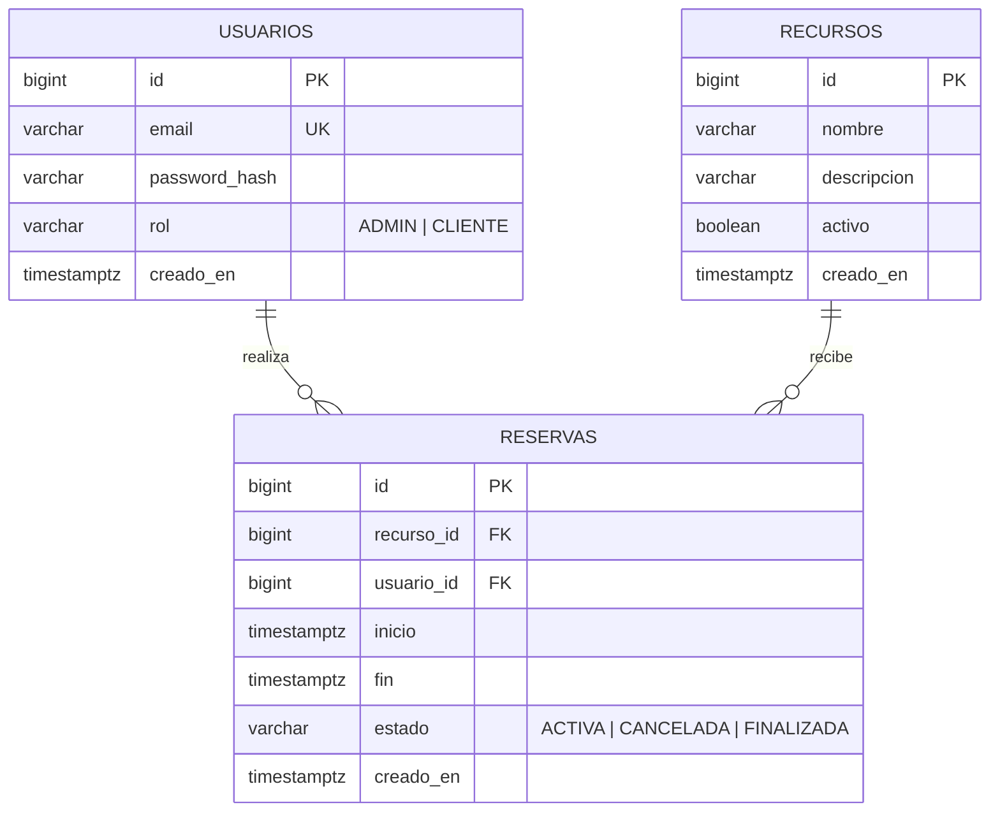

# Reservas API


API REST para reservar recursos (canchas, salas, turnos) por franjas horarias. El foco del proyecto es **garantizar que nunca existan dos reservas activas superpuestas sobre el mismo recurso**, aunque lleguen decenas de solicitudes simultáneas, y demostrarlo con tests.

## Stack

- Java 21, Spring Boot 4, Spring Data JPA
- PostgreSQL 16 con migraciones Flyway
- Spring Security como resource server: autenticación JWT (HS256) y roles
- Tests: JUnit 5, Mockito, MockMvc y Testcontainers (PostgreSQL real)
- Documentación OpenAPI con Swagger UI
- Docker (multi-stage) y GitHub Actions

## Cómo ejecutarlo

Requisitos: JDK 21 y Docker.

```bash
# 1. Levantar PostgreSQL (puerto 5440)
docker compose up -d

# 2. Correr la app (perfil dev por defecto)
./mvnw spring-boot:run
```

La documentación interactiva queda en <http://localhost:8080/swagger-ui/index.html>.

Para crear un usuario administrador al arrancar, definí estas variables de entorno (las credenciales nunca van en el repositorio):

```bash
RESERVAS_ADMIN_EMAIL=admin@ejemplo.com RESERVAS_ADMIN_PASSWORD=una-clave-segura ./mvnw spring-boot:run
```

### Con Docker

```bash
cp .env.example .env        # completá JWT_SECRET con un valor aleatorio de 32+ caracteres
docker compose --profile app up --build
```

El contenedor corre con el perfil `prod`: si falta una credencial, la aplicación **se niega a arrancar**.

### Tests

```bash
./mvnw test
```

Necesita Docker abierto: los tests de integración levantan su propio PostgreSQL con Testcontainers, sin depender de la base de desarrollo.

## Modelo de datos



Las fechas se manejan siempre como instantes en UTC.

## Endpoints

| Método            | Ruta                                  | Acceso      | Descripción                          |
| ----------------- | ------------------------------------- | ----------- | ------------------------------------ |
| POST              | `/api/usuarios`                       | Público     | Registro (siempre crea un `CLIENTE`) |
| POST              | `/api/auth/login`                     | Público     | Devuelve un JWT                      |
| GET               | `/api/recursos`, `/api/recursos/{id}` | Autenticado | Consulta de recursos                 |
| POST, PUT, DELETE | `/api/recursos`, `/api/recursos/{id}` | `ADMIN`     | Alta, edición y baja lógica          |
| POST              | `/api/reservas`                       | Autenticado | Crear una reserva propia             |
| GET               | `/api/reservas?page=0&size=20`        | Autenticado | Mis reservas, paginadas              |
| PATCH             | `/api/reservas/{id}/cancelar`         | Titular     | Cancelar (con anticipación mínima)   |
| GET               | `/actuator/health`                    | Público     | Estado de la aplicación y la base    |

Reglas de negocio: solo se reserva en el futuro, el recurso debe estar activo, y una reserva se cancela hasta 24 horas antes del inicio (configurable). Un job programado pasa a `FINALIZADA` las reservas activas cuyo horario ya terminó.
