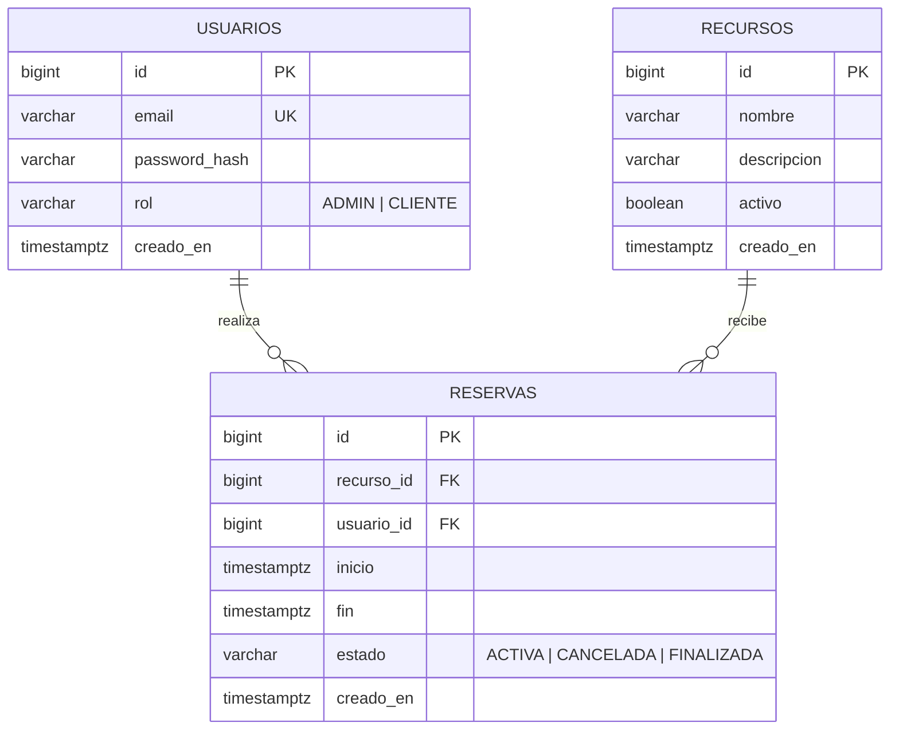

# Reservas API


API REST para reservar recursos (canchas, salas, turnos) por franjas horarias. El foco del proyecto es **garantizar que nunca existan dos reservas activas superpuestas sobre el mismo recurso**, aunque lleguen decenas de solicitudes simultáneas, y demostrarlo con tests.

## Demo en línea

- API: <https://TU-URL.onrender.com>
- Documentación interactiva: <https://TU-URL.onrender.com/swagger-ui/index.html>

La demo corre en el plan gratuito de Render: el servicio se apaga tras 15 minutos sin tráfico, así que **la primera solicitud puede tardar cerca de un minuto**. La base de datos gratuita se recrea periódicamente, por lo que los datos de la demo no son permanentes.

## Stack

- Java 21, Spring Boot 4, Spring Data JPA
- PostgreSQL 16 con migraciones Flyway
- Spring Security como resource server: autenticación JWT (HS256) y roles
- Tests: JUnit 5, Mockito, MockMvc y Testcontainers (PostgreSQL real)
- Documentación OpenAPI con Swagger UI
- Docker (multi-stage) y GitHub Actions

## Cómo ejecutarlo

Requisitos: JDK 21 y Docker.

```bash
# 1. Levantar PostgreSQL (puerto 5440)
docker compose up -d

# 2. Correr la app (perfil dev por defecto)
./mvnw spring-boot:run
```

La documentación interactiva queda en <http://localhost:8080/swagger-ui/index.html>.

Para crear un usuario administrador al arrancar, definí estas variables de entorno (las credenciales nunca van en el repositorio):

```bash
RESERVAS_ADMIN_EMAIL=admin@ejemplo.com RESERVAS_ADMIN_PASSWORD=una-clave-segura ./mvnw spring-boot:run
```

### Con Docker

```bash
cp .env.example .env        # completá JWT_SECRET con un valor aleatorio de 32+ caracteres
docker compose --profile app up --build
```

El contenedor corre con el perfil `prod`: si falta una credencial, la aplicación **se niega a arrancar**.

### Tests

```bash
./mvnw test
```

Necesita Docker abierto: los tests de integración levantan su propio PostgreSQL con Testcontainers, sin depender de la base de desarrollo.

## Modelo de datos



Las fechas se manejan siempre como instantes en UTC.

## Endpoints

| Método            | Ruta                                  | Acceso      | Descripción                          |
| ----------------- | ------------------------------------- | ----------- | ------------------------------------ |
| POST              | `/api/usuarios`                       | Público     | Registro (siempre crea un `CLIENTE`) |
| POST              | `/api/auth/login`                     | Público     | Devuelve un JWT                      |
| GET               | `/api/recursos`, `/api/recursos/{id}` | Autenticado | Consulta de recursos                 |
| POST, PUT, DELETE | `/api/recursos`, `/api/recursos/{id}` | `ADMIN`     | Alta, edición y baja lógica          |
| POST              | `/api/reservas`                       | Autenticado | Crear una reserva propia             |
| GET               | `/api/reservas?page=0&size=20`        | Autenticado | Mis reservas, paginadas              |
| PATCH             | `/api/reservas/{id}/cancelar`         | Titular     | Cancelar (con anticipación mínima)   |
| GET               | `/actuator/health`                    | Público     | Estado de la aplicación y la base    |

Reglas de negocio: solo se reserva en el futuro, el recurso debe estar activo, y una reserva se cancela hasta 24 horas antes del inicio (configurable). Un job programado pasa a `FINALIZADA` las reservas activas cuyo horario ya terminó.

## Decisiones técnicas

**Anti-solapamiento en la base, no en Java.** Un chequeo en Java ("¿hay una reserva que se pisa? no, entonces guardo") tiene una condición de carrera: dos solicitudes simultáneas pasan el chequeo y las dos guardan. La garantía es una _exclusion constraint_ de PostgreSQL (`EXCLUDE USING gist` sobre `recurso_id` y `tstzrange(inicio, fin)`), parcial para reservas `ACTIVA`, con rango semiabierto: 10:00-11:00 y 11:00-12:00 no se pisan. El bloqueo optimista con `@Version` no sirve acá, porque versiona una fila existente y el conflicto ocurre entre dos filas nuevas.

**Bloqueo pesimista por recurso.** El test de concurrencia reveló un _deadlock_ de PostgreSQL cuando varios inserts superpuestos se esperaban en cruz, y salía como un 500. Ahora cada reserva toma primero un bloqueo (`SELECT ... FOR UPDATE`) sobre el recurso: las reservas del mismo recurso se procesan de a una y las de recursos distintos siguen en paralelo. El bloqueo ordena el tráfico; la restricción de la base sigue siendo la garantía final. Costo: el rendimiento por recurso queda serializado, aceptable para este dominio.

**Tests contra PostgreSQL real.** La restricción de exclusión no existe en bases en memoria como H2, así que los tests de integración usan Testcontainers. El test de concurrencia lanza 30 solicitudes simultáneas al mismo horario y exige exactamente una reserva creada.

**JWT stateless con `oauth2-resource-server`.** La validación del token la hace una librería probada en lugar de un filtro escrito a mano. El secreto sale de una variable de entorno y en producción no tiene valor por defecto: sin él, la app no arranca. El id del usuario sale del token (`sub`), nunca del body, así que nadie puede operar en nombre de otro.

**Errores uniformes con `ProblemDetail` (RFC 9457).** Los servicios lanzan excepciones de dominio sin saber de HTTP, y un único `@RestControllerAdvice` las traduce. Los errores de seguridad (401/403), que ocurren en un filtro, se redirigen a ese mismo handler. Intentar cancelar la reserva de otro usuario responde 404 y no 403, para no revelar qué ids existen.

**Estructura por feature.** Cada feature (`recurso`, `reserva`, `usuario`, `auth`) agrupa su controller, service, repositorio, entidad y DTOs. La API nunca expone entidades.

**Configuración.** Migraciones versionadas con Flyway y `ddl-auto=validate`. Propiedades propias tipadas y validadas en `ReservasProperties`. Perfiles `dev` y `prod`, y un `Clock` inyectable que permite testear reglas de tiempo (por ejemplo, el borde exacto de las 24 horas) sin esperar.

## Limitaciones conocidas

- **Los roles viajan en el token.** Si cambia el rol de un usuario, su token sigue valiendo con el rol anterior hasta que vence (60 minutos por defecto). Es una consecuencia de que el JWT sea stateless. No hay _refresh tokens_ ni revocación.
- **Sin protección contra fuerza bruta** en el login (límite de intentos). Además, un email inexistente responde algo más rápido que uno existente, lo que permitiría detectarlo midiendo tiempos.
- **HS256** usa el mismo secreto para firmar y verificar. Alcanza para un único servicio; con varios servicios correspondería firma asimétrica.
- **Job programado sin coordinación:** con más de una instancia correrían todas a la vez. Hoy es inofensivo porque la operación es idempotente; con tareas no idempotentes haría falta algo como ShedLock.
- **Swagger UI es público.**
- **Reglas de dominio mínimas:** no hay duración máxima de reserva, límite de reservas por usuario ni horarios de atención.
- **En el plan gratuito, el job de finalización no corre mientras el servicio duerme.** Al despertar, el primer ciclo recupera lo pendiente.
- **El entorno de demo no es de producción real:** la base gratuita expira y no tiene backups.
